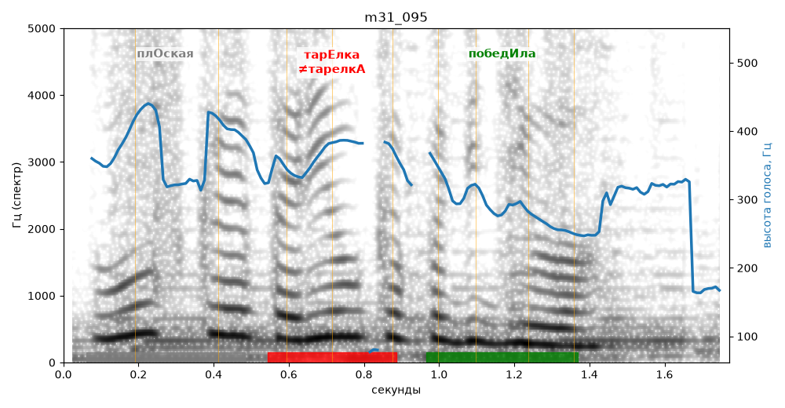

# m31_095

Голос: **Рон (серия 31, 295.2 с)** · длительность 1.8 с
Естественность (UTMOS): **1.37 из 5** (живой диктор ≈ 4–4.5)
Эталон: Плоская тарелка победила!
Распознано: Лузкая тарелка победила!
Расхождения в словах: «плоская» → «лузкая»

## Ударения
(где нужно: ruaccent)

| слово | нужно | у голоса | |
|---|---|---|---|
| плоская | плОская | — | ? |
| тарелка | тарЕлка | тарелкА | ✗ ОШИБКА |
| победила | победИла | победИла | ✓ |

## Интонация
- ✓ «плоская тарелка победила!» — выделено слово «плоская» (+2.4 пт)
- Диапазон голоса 15.8 полутонов (живо), средняя высота 324 Гц

## Паузы и темп
- паузы на своих местах
- Темп 6.9 слога/с (быстро)

_Синяя линия — высота голоса. Над словами заглавная буква — где ударение должно быть; красным — голос поставил не туда (уверенно), оранжевым — возможно._
