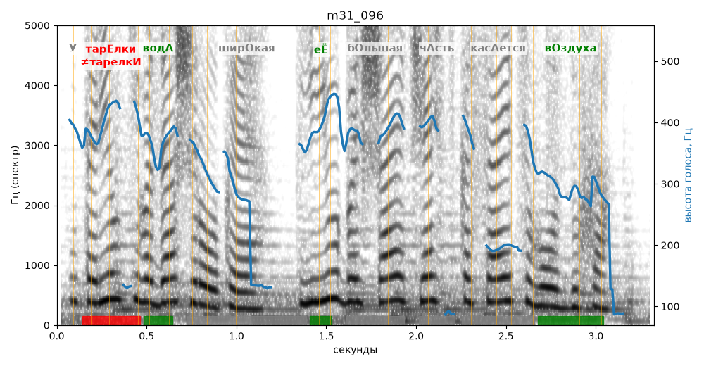

# m31_096

Голос: **Пик (серия 31, 297.1 с)** · длительность 3.3 с
Естественность (UTMOS): **1.28 из 5** (живой диктор ≈ 4–4.5)
Эталон: У тарелки вода широкая. Её большая часть касается воздуха.
Распознано: Утарилки вода широкая. Ею большая часть касается воздуха.
Расхождения в словах: «у тарелки» → «утарилки»; «ее» → «ею»

## Ударения
(где нужно: ruaccent)

| слово | нужно | у голоса | |
|---|---|---|---|
| тарелки | тарЕлки | тарелкИ | ✗ ОШИБКА |
| вода | водА | водА | ✓ |
| широкая | ширОкая | — | ? |
| её | еЁ | еЁ | ✓ |
| большая | бОльшая | — | ? |
| касается | касАется | касаетсЯ | ? не разобрать |
| воздуха | вОздуха | вОздуха | ✓ |

## Интонация
- ✓ «у тарелки вода широкая.» — конец фразы понижается — звучит законченно
- ✓ «её большая часть касается воздуха.» — конец фразы понижается — звучит законченно
- Диапазон голоса 20.8 полутонов (живо), средняя высота 354 Гц

## Паузы и темп
- после «широкая.» пауза всего 0.02 с — фразы слипаются
- Темп 7.1 слога/с (быстро)

_Синяя линия — высота голоса. Над словами заглавная буква — где ударение должно быть; красным — голос поставил не туда (уверенно), оранжевым — возможно._
