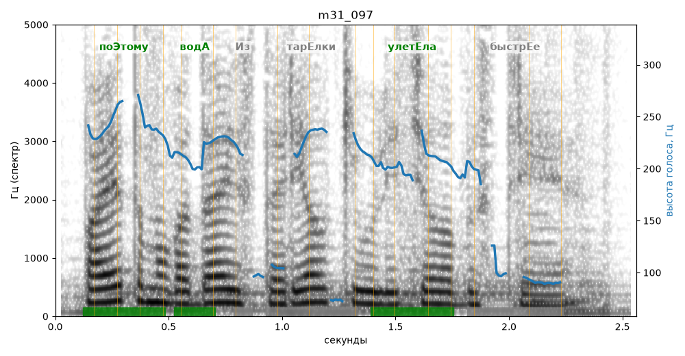

# m31_097

Голос: **Барсик (серия 31, 300.5 с)** · длительность 2.6 с
Естественность (UTMOS): **2.45 из 5** (живой диктор ≈ 4–4.5)
Эталон: Поэтому вода из тарелки улетела быстрее.
Распознано: Поэтому вода из тарелки улетела быстрее.
Слова: все совпали

## Ударения
(где нужно: ruaccent)

| слово | нужно | у голоса | |
|---|---|---|---|
| поэтому | поЭтому | поЭтому | ✓ |
| вода | водА | водА | ✓ |
| тарелки | тарЕлки | тарелкИ | ? не разобрать |
| улетела | улетЕла | улетЕла | ✓ |
| быстрее | быстрЕе | быстреЕ | ? не разобрать |

## Интонация
- ✓ «поэтому вода из тарелки улетела быстрее.» — конец фразы понижается — звучит законченно
- Диапазон голоса 17.3 полутонов (живо), средняя высота 211 Гц

## Паузы и темп
- паузы на своих местах
- Темп 8.0 слога/с (быстро)

_Синяя линия — высота голоса. Над словами заглавная буква — где ударение должно быть; красным — голос поставил не туда (уверенно), оранжевым — возможно._
