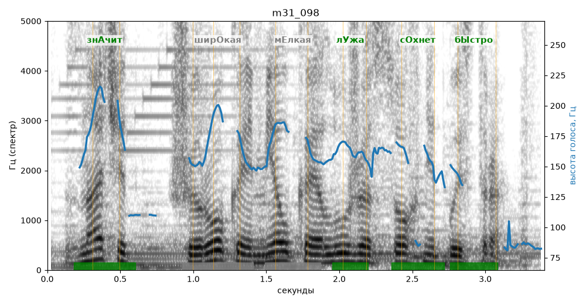

# m31_098

Голос: **Топа (серия 31, 303.2 с)** · длительность 3.4 с
Естественность (UTMOS): **2.36 из 5** (живой диктор ≈ 4–4.5)
Эталон: Значит, широкая мелкая лужа сохнет быстро.
Распознано: Значит, широкая мелкая лужа сохнет быстро.
Слова: все совпали

## Ударения
(где нужно: ruaccent)

| слово | нужно | у голоса | |
|---|---|---|---|
| значит | знАчит | знАчит | ✓ |
| широкая | ширОкая | — | ? |
| мелкая | мЕлкая | — | ? |
| лужа | лУжа | лУжа | ✓ |
| сохнет | сОхнет | сОхнет | ✓ |
| быстро | бЫстро | бЫстро | ✓ |

## Интонация
- ✓ «значит широкая мелкая лужа сохнет быстро.» — конец фразы понижается — звучит законченно
- Диапазон голоса 14.8 полутонов (живо), средняя высота 156 Гц

## Паузы и темп
- паузы на своих местах
- Темп 5.4 слога/с (нормально)

_Синяя линия — высота голоса. Над словами заглавная буква — где ударение должно быть; красным — голос поставил не туда (уверенно), оранжевым — возможно._
