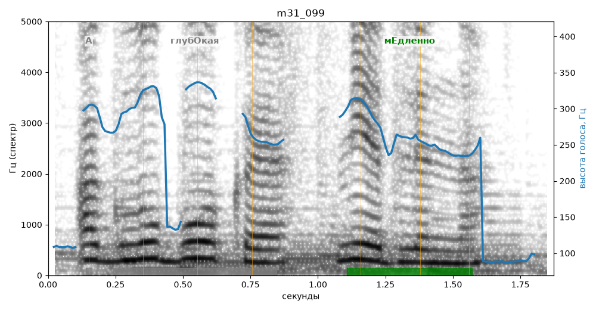

# m31_099

Голос: **Филя (серия 31, 306.7 с)** · длительность 1.9 с
Естественность (UTMOS): **1.61 из 5** (живой диктор ≈ 4–4.5)
Эталон: А глубокая — медленно.
Распознано: А глубокая, медленно.
Слова: все совпали

## Ударения
(где нужно: ruaccent)

| слово | нужно | у голоса | |
|---|---|---|---|
| глубокая | глубОкая | — | ? |
| медленно | мЕдленно | мЕдленно | ✓ |

## Интонация
- ✗ «а глубокая медленно.» — конец фразы не понижается — звучит незаконченно / как перечисление
- Диапазон голоса 22.9 полутонов (живо), средняя высота 259 Гц

## Паузы и темп
- паузы на своих местах
- Темп 6.0 слога/с (нормально)

_Синяя линия — высота голоса. Над словами заглавная буква — где ударение должно быть; красным — голос поставил не туда (уверенно), оранжевым — возможно._
