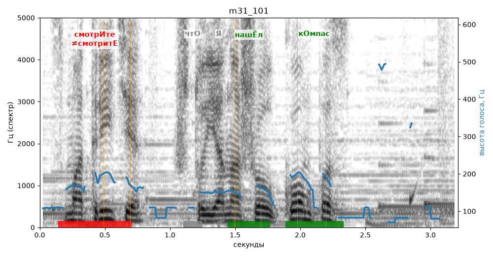

# m31_101

Голос: **Топа (серия 31, 316.0 с)** · длительность 3.2 с
Естественность (UTMOS): **2.25 из 5** (живой диктор ≈ 4–4.5)
Эталон: Смотрите, что я нашёл! Компас!
Распознано: Смотрите, что я нашел компас.
Слова: все совпали

## Ударения
(где нужно: ruaccent)

| слово | нужно | у голоса | |
|---|---|---|---|
| смотрите | смотрИте | смотритЕ | ✗ ОШИБКА |
| нашёл | нашЁл | нашЁл | ✓ |
| компас | кОмпас | кОмпас | ✓ |

## Интонация
- ✓ «смотрите что я нашёл!» — выделено слово «смотрите» (+3.6 пт)
- Диапазон голоса 16.1 полутонов (живо), средняя высота 149 Гц

## Паузы и темп
- после «нашёл!» пауза всего 0.12 с — фразы слипаются
- Темп 4.5 слога/с (нормально)

_Синяя линия — высота голоса. Над словами заглавная буква — где ударение должно быть; красным — голос поставил не туда (уверенно), оранжевым — возможно._
