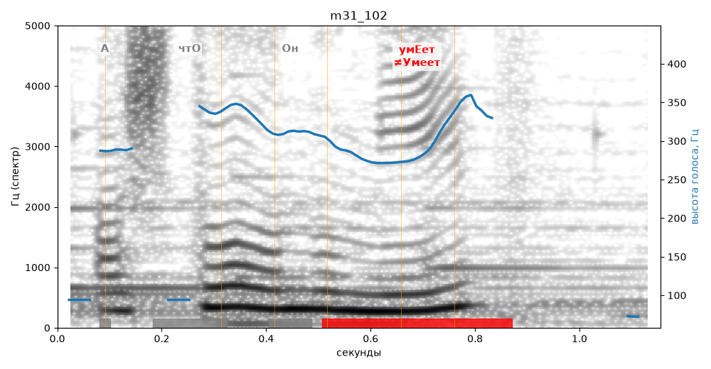

# m31_102

Голос: **Рон (серия 31, 319.3 с)** · длительность 1.2 с
Естественность (UTMOS): **2.12 из 5** (живой диктор ≈ 4–4.5)
Эталон: А что он умеет?
Распознано: А что он умеет?
Слова: все совпали

## Ударения
(где нужно: ruaccent)

| слово | нужно | у голоса | |
|---|---|---|---|
| умеет | умЕет | Умеет | ✗ ОШИБКА |

## Интонация
- ✗ «а что он умеет?» — нет вопросительного подъёма (самое высокое место — «что», в начале) — звучит как утверждение
- Диапазон голоса 22.6 полутонов (живо), средняя высота 293 Гц

## Паузы и темп
- паузы на своих местах
- Темп 7.6 слога/с (быстро)

_Синяя линия — высота голоса. Над словами заглавная буква — где ударение должно быть; красным — голос поставил не туда (уверенно), оранжевым — возможно._
