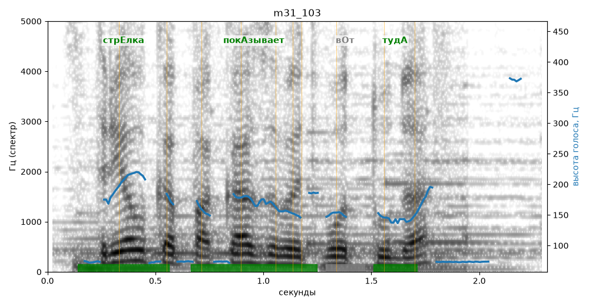

# m31_103

Голос: **Топа (серия 31, 320.6 с)** · длительность 2.3 с
Естественность (UTMOS): **2.34 из 5** (живой диктор ≈ 4–4.5)
Эталон: Стрелка показывает вот туда.
Распознано: Стрелка показывает вот туда.
Слова: все совпали

## Ударения
(где нужно: ruaccent)

| слово | нужно | у голоса | |
|---|---|---|---|
| стрелка | стрЕлка | стрЕлка | ✓ |
| показывает | покАзывает | покАзывает | ✓ |
| туда | тудА | тудА | ✓ |

## Интонация
- ✗ «стрелка показывает вот туда.» — конец фразы не понижается — звучит незаконченно / как перечисление
- Диапазон голоса 19.0 полутонов (живо), средняя высота 152 Гц

## Паузы и темп
- паузы на своих местах
- Темп 6.4 слога/с (нормально)

_Синяя линия — высота голоса. Над словами заглавная буква — где ударение должно быть; красным — голос поставил не туда (уверенно), оранжевым — возможно._
