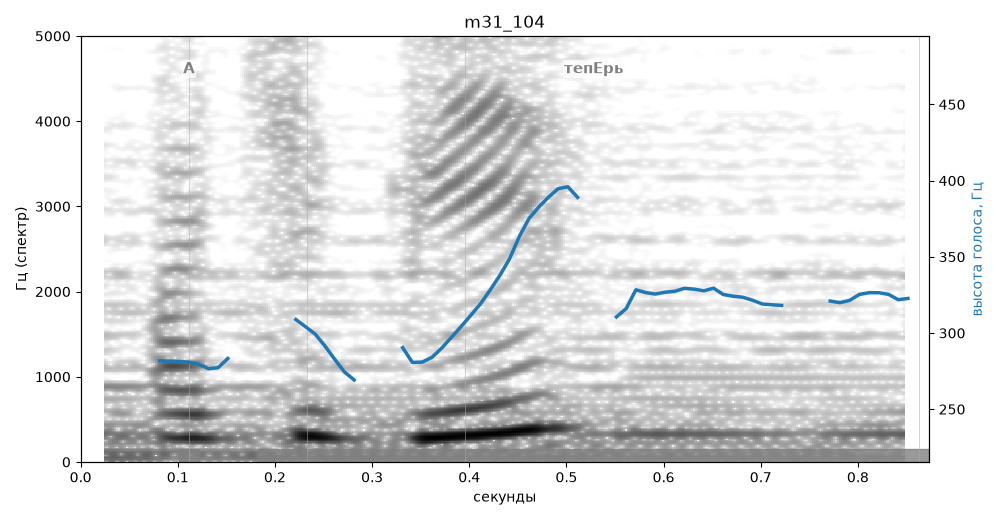

# m31_104

Голос: **Рон (серия 31, 323.0 с)** · длительность 0.9 с
Естественность (UTMOS): **2.15 из 5** (живой диктор ≈ 4–4.5)
Эталон: А теперь?
Распознано: А теперь?
Слова: все совпали

## Ударения
(где нужно: ruaccent)

| слово | нужно | у голоса | |
|---|---|---|---|
| теперь | тепЕрь | — | ? |

## Интонация
- ✗ «а теперь?» — нет вопросительного подъёма (самое высокое место — «теперь», в начале) — звучит как утверждение
- Диапазон голоса 5.9 полутонов (нормально), средняя высота 321 Гц

## Паузы и темп
- паузы на своих местах
- Темп 5.2 слога/с (нормально)

_Синяя линия — высота голоса. Над словами заглавная буква — где ударение должно быть; красным — голос поставил не туда (уверенно), оранжевым — возможно._
