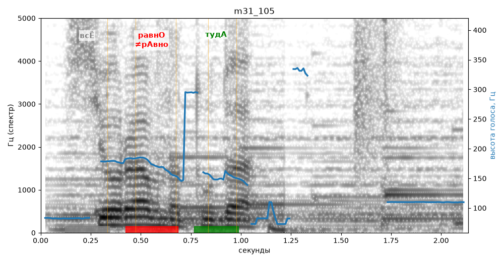

# m31_105

Голос: **Топа (серия 31, 324.0 с)** · длительность 2.1 с
Естественность (UTMOS): **1.36 из 5** (живой диктор ≈ 4–4.5)
Эталон: Всё равно туда!
Распознано: Всё равно туда.
Слова: все совпали

## Ударения
(где нужно: ruaccent)

| слово | нужно | у голоса | |
|---|---|---|---|
| равно | равнО | рАвно | ✗ ОШИБКА |
| туда | тудА | тудА | ✓ |

## Интонация
- ✗ «всё равно туда!» — восклицание звучит ровно, без эмоции
- Диапазон голоса 22.2 полутонов (живо), средняя высота 110 Гц

## Паузы и темп
- паузы на своих местах
- Темп 5.8 слога/с (нормально)

_Синяя линия — высота голоса. Над словами заглавная буква — где ударение должно быть; красным — голос поставил не туда (уверенно), оранжевым — возможно._
