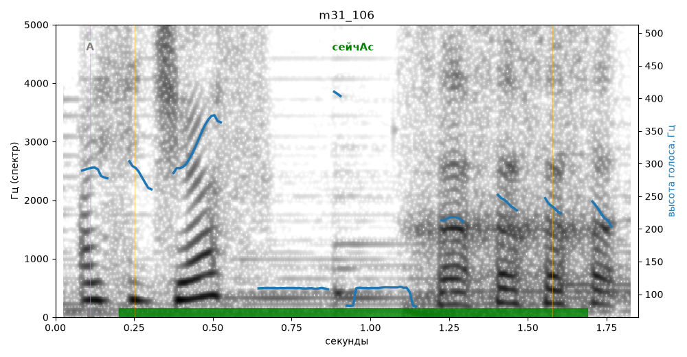

# m31_106

Голос: **Рон (серия 31, 326.3 с)** · длительность 1.9 с
Естественность (UTMOS): **1.62 из 5** (живой диктор ≈ 4–4.5)
Эталон: А сейчас?
Распознано: А сейчас?
Слова: все совпали

## Ударения
(где нужно: ruaccent)

| слово | нужно | у голоса | |
|---|---|---|---|
| сейчас | сейчАс | сейчАс | ✓ |

## Интонация
- ✗ «а сейчас?» — нет вопросительного подъёма (самое высокое место — «а», в начале) — звучит как утверждение
- Диапазон голоса 21.6 полутонов (живо), средняя высота 218 Гц

## Паузы и темп
- паузы на своих местах
- Темп 1.9 слога/с (медленно)

_Синяя линия — высота голоса. Над словами заглавная буква — где ударение должно быть; красным — голос поставил не туда (уверенно), оранжевым — возможно._
