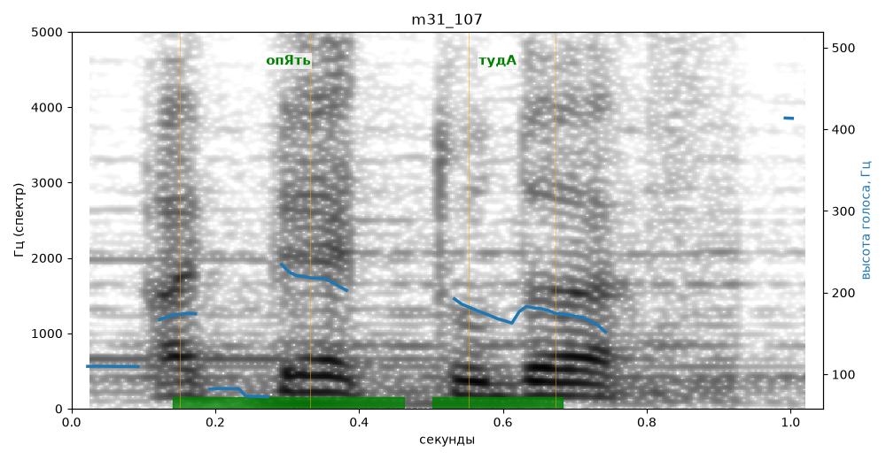

# m31_107

Голос: **Топа (серия 31, 328.3 с)** · длительность 1.0 с
Естественность (UTMOS): **1.81 из 5** (живой диктор ≈ 4–4.5)
Эталон: Опять туда!
Распознано: Опять туда!
Слова: все совпали

## Ударения
(где нужно: ruaccent)

| слово | нужно | у голоса | |
|---|---|---|---|
| опять | опЯть | опЯть | ✓ |
| туда | тудА | тудА | ✓ |

## Интонация
- ✓ «опять туда!» — выделено слово «опять» (+3.6 пт)
- Диапазон голоса 21.6 полутонов (живо), средняя высота 173 Гц

## Паузы и темп
- паузы на своих местах
- Темп 7.4 слога/с (быстро)

_Синяя линия — высота голоса. Над словами заглавная буква — где ударение должно быть; красным — голос поставил не туда (уверенно), оранжевым — возможно._
