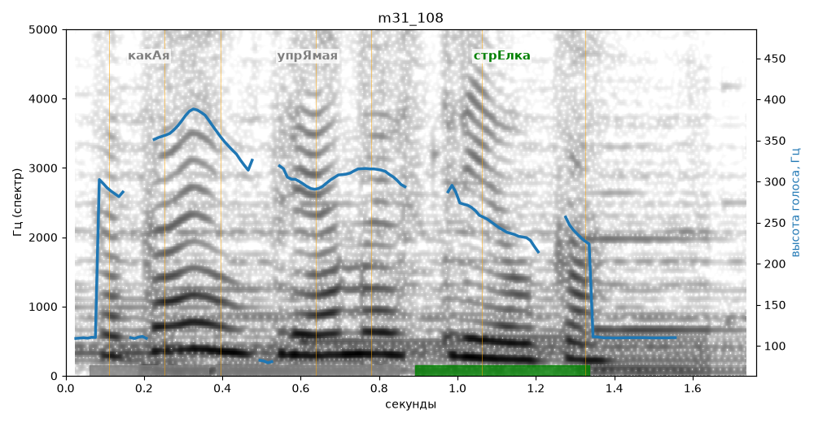

# m31_108

Голос: **Рон (серия 31, 329.4 с)** · длительность 1.8 с
Естественность (UTMOS): **1.46 из 5** (живой диктор ≈ 4–4.5)
Эталон: Какая упрямая стрелка!
Распознано: Какая он прямая стрелка?
Расхождения в словах: «упрямая» → «он прямая»

## Ударения
(где нужно: ruaccent)

| слово | нужно | у голоса | |
|---|---|---|---|
| какая | какАя | — | ? |
| упрямая | упрЯмая | — | ? |
| стрелка | стрЕлка | стрЕлка | ✓ |

## Интонация
- ✓ «какая упрямая стрелка!» — выделено слово «какая» (+2.9 пт)
- Диапазон голоса 21.3 полутонов (живо), средняя высота 286 Гц

## Паузы и темп
- паузы на своих местах
- Темп 5.5 слога/с (нормально)

_Синяя линия — высота голоса. Над словами заглавная буква — где ударение должно быть; красным — голос поставил не туда (уверенно), оранжевым — возможно._
