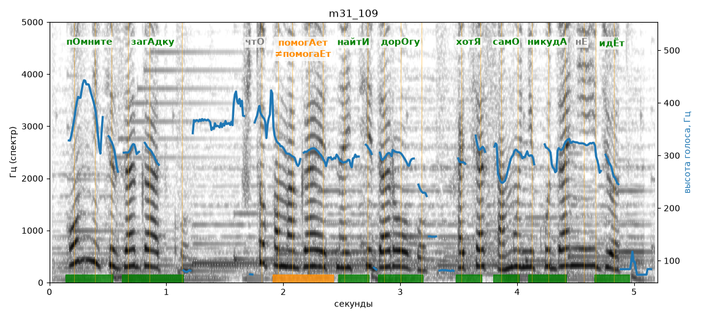

# m31_109

Голос: **Филя (серия 31, 331.3 с)** · длительность 5.2 с
Естественность (UTMOS): **1.8 из 5** (живой диктор ≈ 4–4.5)
Эталон: Помните загадку? Что помогает найти дорогу, хотя само никуда не идёт?
Распознано: Помните загадку, что помогает найти дорогу, хотя само никуда не идет.
Слова: все совпали

## Ударения
(где нужно: ruaccent)

| слово | нужно | у голоса | |
|---|---|---|---|
| помните | пОмните | пОмните | ✓ |
| загадку | загАдку | загАдку | ✓ |
| помогает | помогАет | помогаЕт | ✗? возможно — послушать |
| найти | найтИ | найтИ | ✓ |
| дорогу | дорОгу | дорОгу | ✓ |
| хотя | хотЯ | хотЯ | ✓ |
| само | самО | самО | ✓ |
| никуда | никудА | никудА | ✓ |
| идёт | идЁт | идЁт | ✓ |

## Интонация
- ✗ «помните загадку?» — нет вопросительного подъёма (самое высокое место — «помните», в начале) — звучит как утверждение
- ✓ «что помогает найти дорогу хотя само никуда не идёт?» — конец фразы понижается — звучит законченно
- Диапазон голоса 27.7 полутонов (живо), средняя высота 305 Гц

## Паузы и темп
- паузы на своих местах
- Темп 6.5 слога/с (нормально)

_Синяя линия — высота голоса. Над словами заглавная буква — где ударение должно быть; красным — голос поставил не туда (уверенно), оранжевым — возможно._
