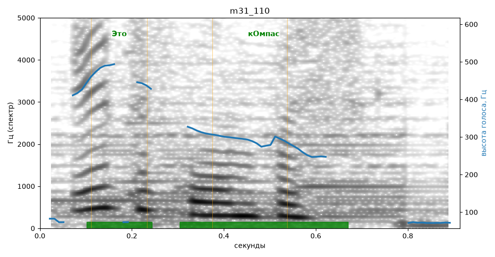

# m31_110

Голос: **Пик (серия 31, 336.6 с)** · длительность 0.9 с
Естественность (UTMOS): **1.41 из 5** (живой диктор ≈ 4–4.5)
Эталон: Это компас!
Распознано: avesnk
Расхождения в словах: «это компас» → «»

## Ударения
(где нужно: ruaccent)

| слово | нужно | у голоса | |
|---|---|---|---|
| это | Это | Это | ✓ |
| компас | кОмпас | кОмпас | ✓ |

## Интонация
- ✓ «это компас!» — выделено слово «это» (+3.8 пт)
- Диапазон голоса 33.1 полутонов (живо), средняя высота 290 Гц

## Паузы и темп
- паузы на своих местах
- Темп 7.0 слога/с (быстро)

_Синяя линия — высота голоса. Над словами заглавная буква — где ударение должно быть; красным — голос поставил не туда (уверенно), оранжевым — возможно._
