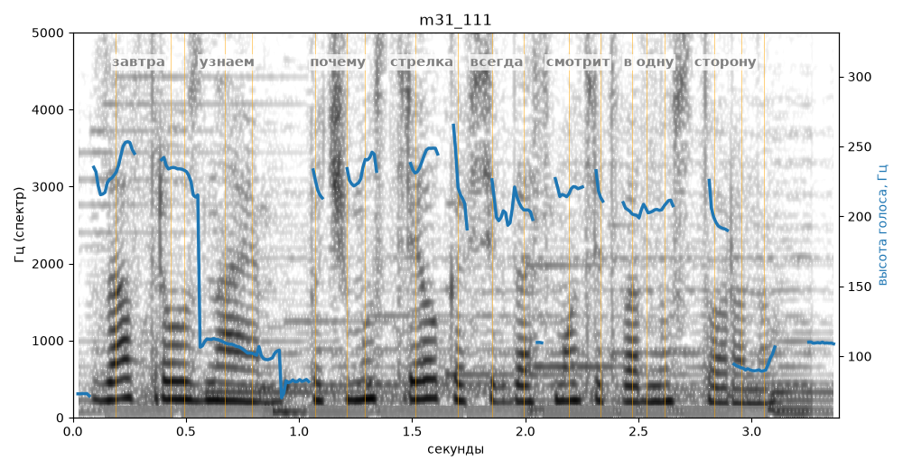

# m31_111

Голос: **Барсик (серия 31, 337.7 с)** · длительность 3.4 с
Естественность (UTMOS): **2.23 из 5** (живой диктор ≈ 4–4.5)
Эталон: Завтра узнаем, почему стрелка всегда смотрит в одну сторону.
Распознано: Завтра узнаем, почему стрелка всегда смотрит в одну сторону.
Слова: все совпали

## Ударения
(где нужно: нет)

| слово | нужно | у голоса | |
|---|---|---|---|
| завтра | завтра | зАвтра | нет эталона |
| узнаем | узнаем | узнАем | нет эталона |
| почему | почему | почемУ | нет эталона |
| стрелка | стрелка | стрЕлка | нет эталона |
| всегда | всегда | всегдА | нет эталона |
| смотрит | смотрит | смОтрит | нет эталона |
| одну | одну | однУ | нет эталона |
| сторону | сторону | стОрону | нет эталона |

## Интонация
- ✓ «завтра узнаем почему стрелка всегда смотрит в одну сторону.» — конец фразы понижается — звучит законченно
- Диапазон голоса 19.0 полутонов (живо), средняя высота 205 Гц

## Паузы и темп
- паузы на своих местах
- Темп 7.2 слога/с (быстро)

_Синяя линия — высота голоса. Над словами заглавная буква — где ударение должно быть; красным — голос поставил не туда (уверенно), оранжевым — возможно._
