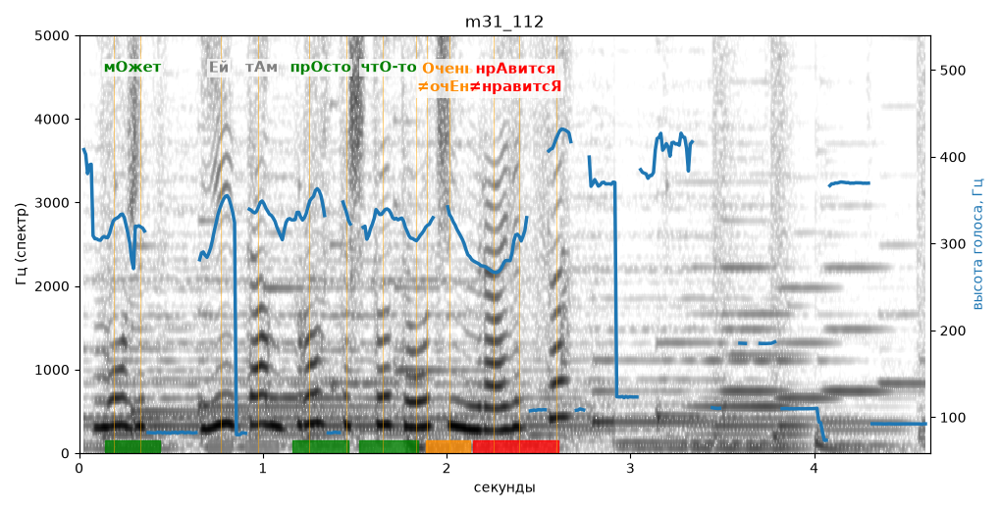

# m31_112

Голос: **Рон (серия 31, 341.2 с)** · длительность 4.6 с
Естественность (UTMOS): **1.28 из 5** (живой диктор ≈ 4–4.5)
Эталон: Может, ей там просто что-то очень нравится?
Распознано: Может, ей там просто что-то очень нравится?
Слова: все совпали

## Ударения
(где нужно: ruaccent)

| слово | нужно | у голоса | |
|---|---|---|---|
| может | мОжет | мОжет | ✓ |
| просто | прОсто | прОсто | ✓ |
| что-то | чтО-то | чтО-то | ✓ |
| очень | Очень | очЕнь | ✗? возможно — послушать |
| нравится | нрАвится | нравитсЯ | ✗ ОШИБКА |

## Интонация
- ✗ «может ей там просто что-то очень нравится?» — нет вопросительного подъёма (самое высокое место — «просто», в начале) — звучит как утверждение
- Диапазон голоса 28.1 полутонов (живо), средняя высота 309 Гц

## Паузы и темп
- паузы на своих местах
- Темп 5.9 слога/с (нормально)

_Синяя линия — высота голоса. Над словами заглавная буква — где ударение должно быть; красным — голос поставил не туда (уверенно), оранжевым — возможно._
