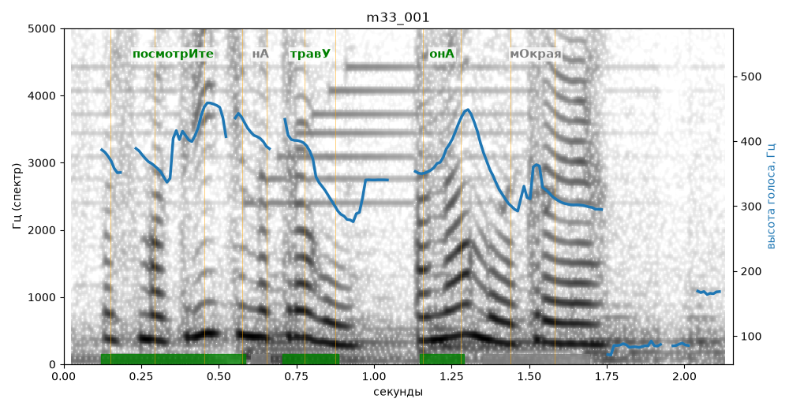

# m33_001

Голос: **Серия 33, Пик (17.3 с), голос iPhone** · длительность 2.2 с
Естественность (UTMOS): **1.25 из 5** (живой диктор ≈ 4–4.5)
Эталон: Посмотрите на траву. Она мокрая.
Распознано: Посмотрите на траву! Она мокрая!
Слова: все совпали

## Ударения
(где нужно: ruaccent)

| слово | нужно | у голоса | |
|---|---|---|---|
| посмотрите | посмотрИте | посмотрИте | ✓ |
| траву | травУ | травУ | ✓ |
| она | онА | онА | ✓ |
| мокрая | мОкрая | — | ? |

## Интонация
- ✓ «посмотрите на траву.» — конец фразы понижается — звучит законченно
- ✓ «она мокрая.» — конец фразы понижается — звучит законченно
- Диапазон голоса 28.5 полутонов (живо), средняя высота 342 Гц

## Паузы и темп
- паузы на своих местах
- Темп 8.4 слога/с (быстро)

_Синяя линия — высота голоса. Над словами заглавная буква — где ударение должно быть; красным — голос поставил не туда (уверенно), оранжевым — возможно._
