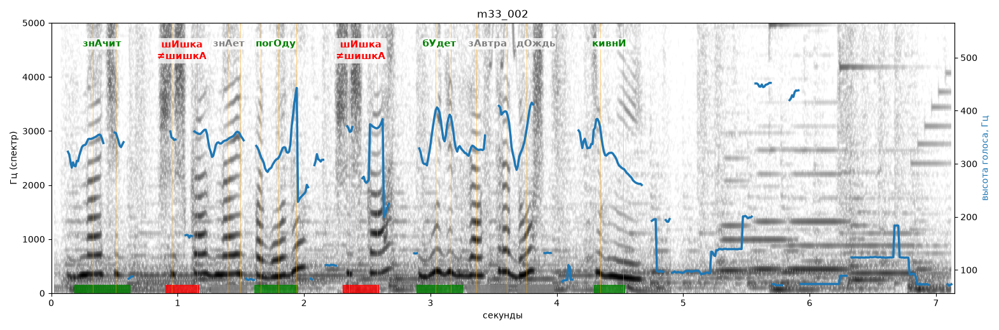

# m33_002

Голос: **Серия 33, Рон (26.7 с), голос iPhone** · длительность 7.1 с
Естественность (UTMOS): **1.25 из 5** (живой диктор ≈ 4–4.5)
Эталон: Значит, шишка знает погоду? Шишка, будет завтра дождь? Кивни!
Распознано: Значит, шишка знает погоду, шишка будет завтра дождь кивней.
Расхождения в словах: «кивни» → «кивней»

## Ударения
(где нужно: ruaccent)

| слово | нужно | у голоса | |
|---|---|---|---|
| значит | знАчит | знАчит | ✓ |
| шишка | шИшка | шишкА | ✗ ОШИБКА |
| знает | знАет | знаЕт | ? не разобрать |
| погоду | погОду | погОду | ✓ |
| шишка | шИшка | шишкА | ✗ ОШИБКА |
| будет | бУдет | бУдет | ✓ |
| завтра | зАвтра | завтрА | ? не разобрать |
| кивни | кивнИ | кивнИ | ✓ |

## Интонация
- ✗ «значит шишка знает погоду?» — нет вопросительного подъёма (самое высокое место — «шишка», в начале) — звучит как утверждение
- ✗ «шишка будет завтра дождь?» — нет вопросительного подъёма (самое высокое место — «шишка», в начале) — звучит как утверждение
- Диапазон голоса 29.7 полутонов (живо), средняя высота 290 Гц

## Паузы и темп
- паузы на своих местах
- Темп 5.8 слога/с (нормально)

_Синяя линия — высота голоса. Над словами заглавная буква — где ударение должно быть; красным — голос поставил не туда (уверенно), оранжевым — возможно._
