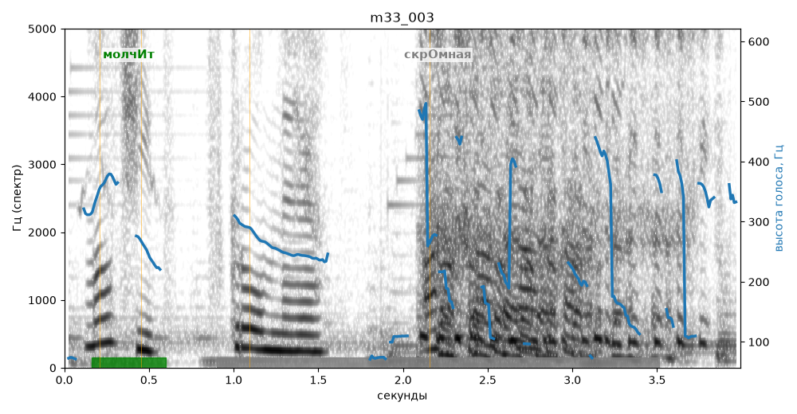

# m33_003

Голос: **Серия 33, Рон (33.8 с), голос iPhone** · длительность 4.0 с
Естественность (UTMOS): **1.26 из 5** (живой диктор ≈ 4–4.5)
Эталон: Молчит. Скромная.
Распознано: Молчит скромное.
Расхождения в словах: «скромная» → «скромное»

## Ударения
(где нужно: ruaccent)

| слово | нужно | у голоса | |
|---|---|---|---|
| молчит | молчИт | молчИт | ✓ |
| скромная | скрОмная | — | ? |

## Интонация
- Диапазон голоса 29.9 полутонов (живо), средняя высота 244 Гц

## Паузы и темп
- паузы на своих местах
- Темп 1.3 слога/с (медленно)

_Синяя линия — высота голоса. Над словами заглавная буква — где ударение должно быть; красным — голос поставил не туда (уверенно), оранжевым — возможно._
