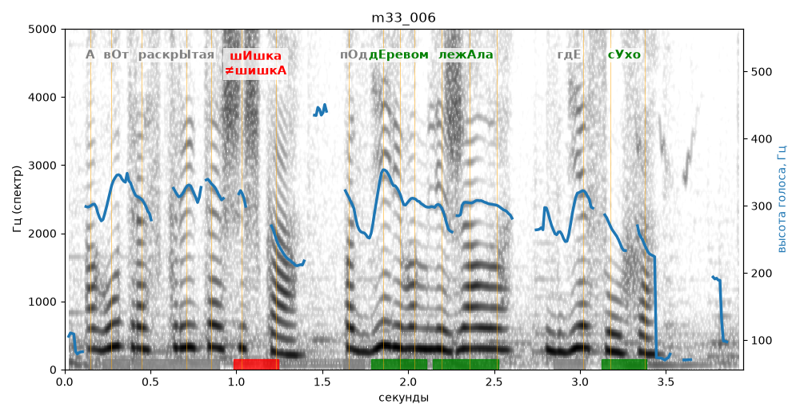

# m33_006

Голос: **Серия 33, Рон (55.6 с), голос iPhone** · длительность 3.9 с
Естественность (UTMOS): **2.17 из 5** (живой диктор ≈ 4–4.5)
Эталон: А вот раскрытая шишка. Под деревом лежала, где сухо.
Распознано: А вот раскрытая шишка, под деревом лежала, где сухо.
Слова: все совпали

## Ударения
(где нужно: ruaccent)

| слово | нужно | у голоса | |
|---|---|---|---|
| раскрытая | раскрЫтая | — | ? |
| шишка | шИшка | шишкА | ✗ ОШИБКА |
| деревом | дЕревом | дЕревом | ✓ |
| лежала | лежАла | лежАла | ✓ |
| сухо | сУхо | сУхо | ✓ |

## Интонация
- ✗ «а вот раскрытая шишка.» — конец фразы не понижается — звучит незаконченно / как перечисление
- ✓ «под деревом лежала где сухо.» — конец фразы понижается — звучит законченно
- Диапазон голоса 25.4 полутонов (живо), средняя высота 298 Гц

## Паузы и темп
- паузы на своих местах
- Темп 6.7 слога/с (быстро)

_Синяя линия — высота голоса. Над словами заглавная буква — где ударение должно быть; красным — голос поставил не туда (уверенно), оранжевым — возможно._
