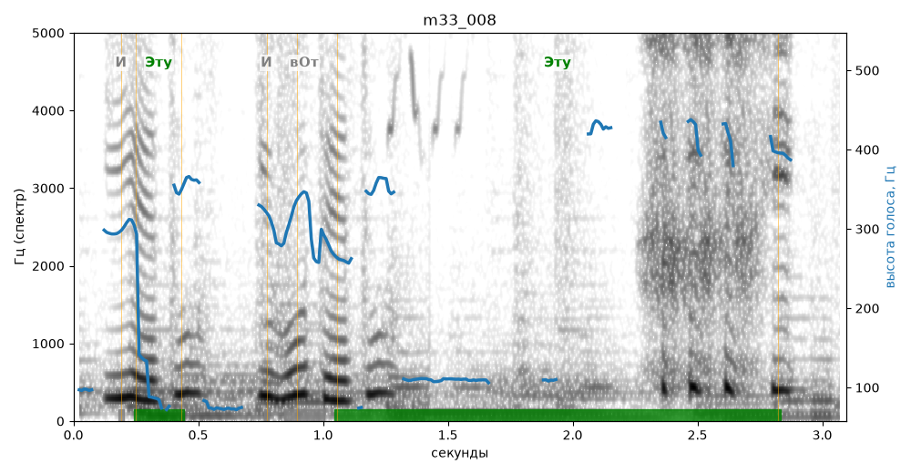

# m33_008

Голос: **Серия 33, Рон (68.7 с), голос iPhone** · длительность 3.1 с
Естественность (UTMOS): **1.28 из 5** (живой диктор ≈ 4–4.5)
Эталон: И эту. И вот эту!
Распознано: И эту, и вот эту.
Слова: все совпали

## Ударения
(где нужно: ruaccent)

| слово | нужно | у голоса | |
|---|---|---|---|
| эту | Эту | Эту | ✓ |
| эту | Эту | Эту | ✓ |

## Интонация
- ✓ «и эту.» — конец фразы понижается — звучит законченно
- ✗ «и вот эту!» — восклицание звучит ровно, без эмоции
- Диапазон голоса 30.6 полутонов (живо), средняя высота 282 Гц

## Паузы и темп
- паузы на своих местах
- Темп 3.0 слога/с (медленно)

_Синяя линия — высота голоса. Над словами заглавная буква — где ударение должно быть; красным — голос поставил не туда (уверенно), оранжевым — возможно._
