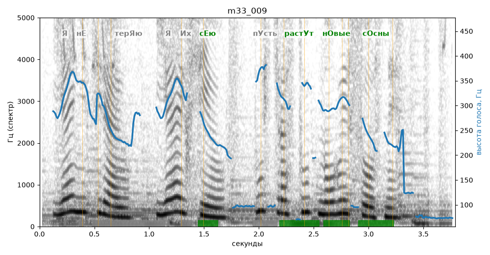

# m33_009

Голос: **Серия 33, Рон (74.5 с), голос iPhone** · длительность 3.8 с
Естественность (UTMOS): **1.47 из 5** (живой диктор ≈ 4–4.5)
Эталон: Я не теряю. Я их сею. Пусть растут новые сосны.
Распознано: Я не теряю, я их силу, пусть растут новые сосны.
Расхождения в словах: «сею» → «силу»

## Ударения
(где нужно: ruaccent)

| слово | нужно | у голоса | |
|---|---|---|---|
| теряю | терЯю | — | ? |
| сею | сЕю | сЕю | ✓ |
| растут | растУт | растУт | ✓ |
| новые | нОвые | нОвые | ✓ |
| сосны | сОсны | сОсны | ✓ |

## Интонация
- ✓ «я не теряю.» — конец фразы понижается — звучит законченно
- ✓ «пусть растут новые сосны.» — конец фразы понижается — звучит законченно
- Диапазон голоса 27.2 полутонов (живо), средняя высота 254 Гц

## Паузы и темп
- после «теряю.» пауза всего 0.02 с — фразы слипаются
- Темп 4.8 слога/с (нормально)

_Синяя линия — высота голоса. Над словами заглавная буква — где ударение должно быть; красным — голос поставил не туда (уверенно), оранжевым — возможно._
