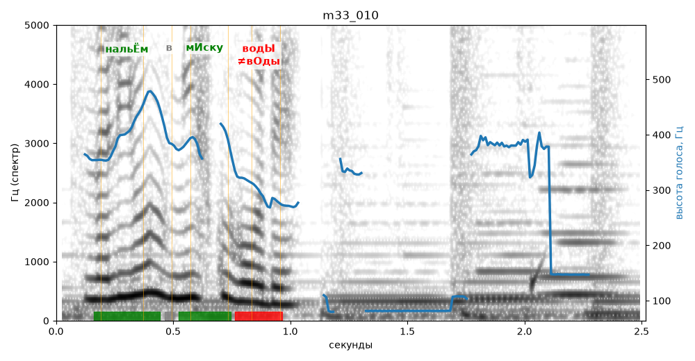

# m33_010

Голос: **Серия 33, Пик (84.5 с), голос iPhone** · длительность 2.5 с
Естественность (UTMOS): **1.32 из 5** (живой диктор ≈ 4–4.5)
Эталон: Нальём в миску воды.
Распознано: Налей он в низку воде.
Расхождения в словах: «нальем» → «налей он»; «миску воды» → «низку воде»

## Ударения
(где нужно: ruaccent)

| слово | нужно | у голоса | |
|---|---|---|---|
| нальём | нальЁм | нальЁм | ✓ |
| миску | мИску | мИску | ✓ |
| воды | водЫ | вОды | ✗ ОШИБКА |

## Интонация
- ✓ «нальём в миску воды.» — конец фразы понижается — звучит законченно
- Диапазон голоса 29.0 полутонов (живо), средняя высота 329 Гц

## Паузы и темп
- паузы на своих местах
- Темп 8.7 слога/с (быстро)

_Синяя линия — высота голоса. Над словами заглавная буква — где ударение должно быть; красным — голос поставил не туда (уверенно), оранжевым — возможно._
