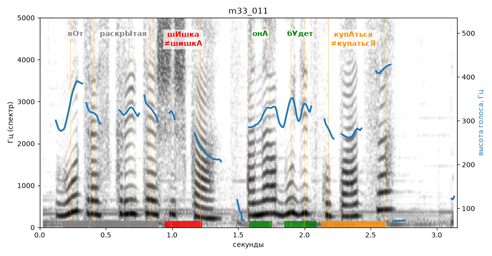

# m33_011

Голос: **Серия 33, Рон (87.0 с), голос iPhone** · длительность 3.2 с
Естественность (UTMOS): **1.94 из 5** (живой диктор ≈ 4–4.5)
Эталон: Вот раскрытая шишка. Она будет купаться?
Распознано: Вот раскрытая шишка, она будет купаться?
Слова: все совпали

## Ударения
(где нужно: ruaccent)

| слово | нужно | у голоса | |
|---|---|---|---|
| раскрытая | раскрЫтая | — | ? |
| шишка | шИшка | шишкА | ✗ ОШИБКА |
| она | онА | онА | ✓ |
| будет | бУдет | бУдет | ✓ |
| купаться | купАться | купатьсЯ | ✗? возможно — послушать |

## Интонация
- ✗ «вот раскрытая шишка.» — конец фразы не понижается — звучит незаконченно / как перечисление
- ✗ «она будет купаться?» — нет вопросительного подъёма (самое высокое место — «она», в начале) — звучит как утверждение
- Диапазон голоса 30.0 полутонов (живо), средняя высота 304 Гц

## Паузы и темп
- паузы на своих местах
- Темп 6.3 слога/с (нормально)

_Синяя линия — высота голоса. Над словами заглавная буква — где ударение должно быть; красным — голос поставил не туда (уверенно), оранжевым — возможно._
