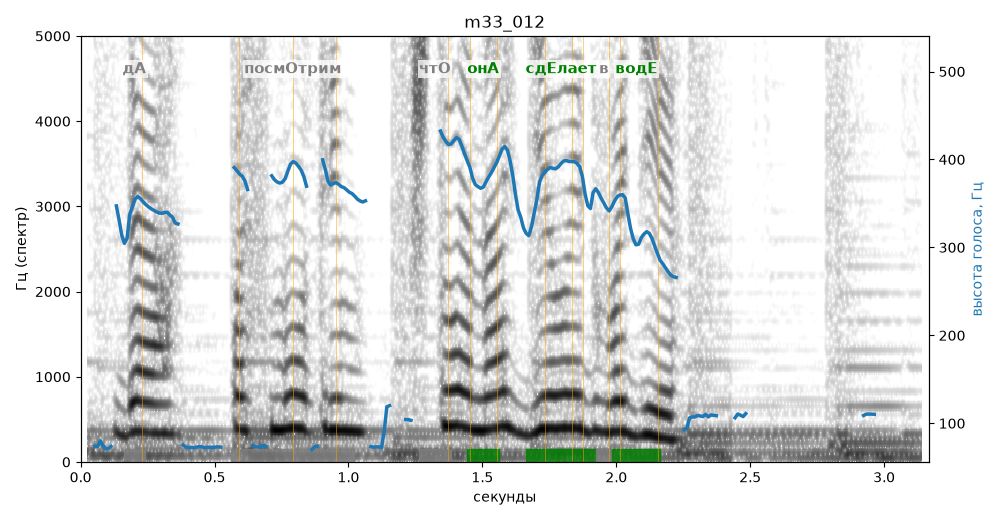

# m33_012

Голос: **Серия 33, Пик (90.1 с), голос iPhone** · длительность 3.2 с
Естественность (UTMOS): **1.34 из 5** (живой диктор ≈ 4–4.5)
Эталон: Да. Посмотрим, что она сделает в воде.
Распознано: Да, посмотрим, что она делает в воде.
Расхождения в словах: «сделает» → «делает»

## Ударения
(где нужно: ruaccent)

| слово | нужно | у голоса | |
|---|---|---|---|
| посмотрим | посмОтрим | посмотрИм | ? не разобрать |
| она | онА | онА | ✓ |
| сделает | сдЕлает | сдЕлает | ✓ |
| воде | водЕ | водЕ | ✓ |

## Интонация
- ✓ «посмотрим что она сделает в воде.» — конец фразы понижается — звучит законченно
- Диапазон голоса 30.0 полутонов (живо), средняя высота 343 Гц

## Паузы и темп
- паузы на своих местах
- Темп 9.0 слога/с (быстро)

_Синяя линия — высота голоса. Над словами заглавная буква — где ударение должно быть; красным — голос поставил не туда (уверенно), оранжевым — возможно._
