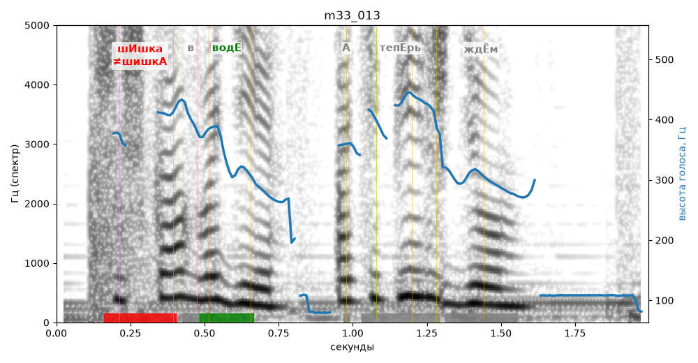

# m33_013

Голос: **Серия 33, Пик (93.2 с), голос iPhone** · длительность 2.0 с
Естественность (UTMOS): **1.78 из 5** (живой диктор ≈ 4–4.5)
Эталон: Шишка в воде. А теперь ждём.
Распознано: Шишка в воде, а теперь ждём.
Слова: все совпали

## Ударения
(где нужно: ruaccent)

| слово | нужно | у голоса | |
|---|---|---|---|
| шишка | шИшка | шишкА | ✗ ОШИБКА |
| воде | водЕ | водЕ | ✓ |
| теперь | тепЕрь | — | ? |

## Интонация
- ✓ «шишка в воде.» — конец фразы понижается — звучит законченно
- ✓ «а теперь ждём.» — конец фразы понижается — звучит законченно
- Диапазон голоса 28.8 полутонов (живо), средняя высота 301 Гц

## Паузы и темп
- паузы на своих местах
- Темп 9.2 слога/с (быстро)

_Синяя линия — высота голоса. Над словами заглавная буква — где ударение должно быть; красным — голос поставил не туда (уверенно), оранжевым — возможно._
