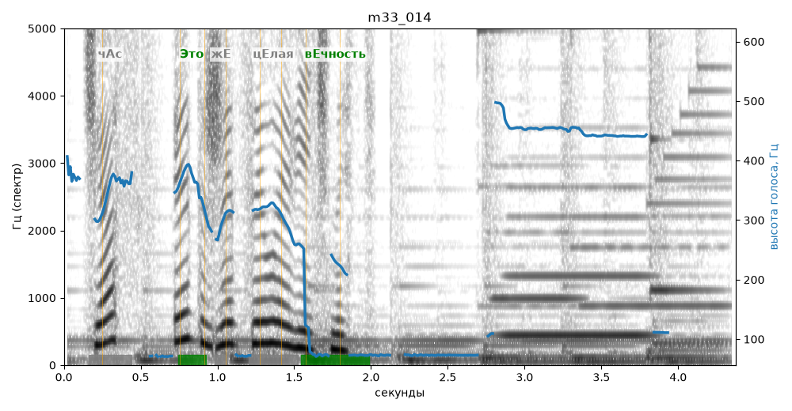

# m33_014

Голос: **Серия 33, Рон (97.4 с), голос iPhone** · длительность 4.4 с
Естественность (UTMOS): **1.41 из 5** (живой диктор ≈ 4–4.5)
Эталон: Час? Это же целая вечность!
Распознано: Час – это же целая вечность.
Слова: все совпали

## Ударения
(где нужно: ruaccent)

| слово | нужно | у голоса | |
|---|---|---|---|
| это | Это | Это | ✓ |
| целая | цЕлая | — | ? |
| вечность | вЕчность | вЕчность | ✓ |

## Интонация
- ✓ «это же целая вечность!» — выделено слово «это» (+2.5 пт)
- Диапазон голоса 32.0 полутонов (живо), средняя высота 313 Гц

## Паузы и темп
- паузы на своих местах
- Темп 5.2 слога/с (нормально)

_Синяя линия — высота голоса. Над словами заглавная буква — где ударение должно быть; красным — голос поставил не туда (уверенно), оранжевым — возможно._
