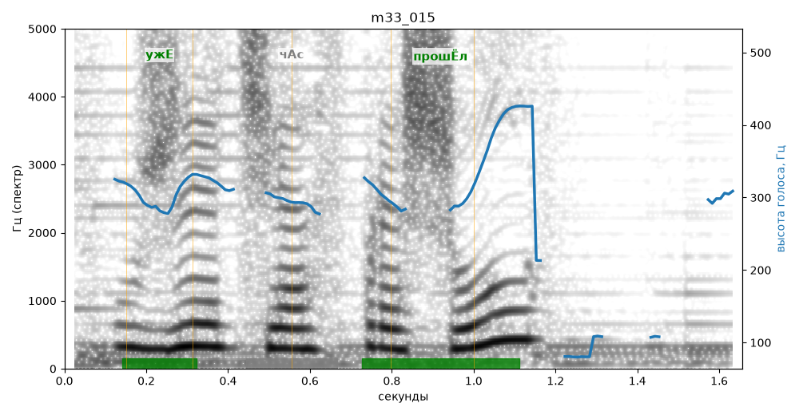

# m33_015

Голос: **Серия 33, Рон (101.7 с), голос iPhone** · длительность 1.7 с
Естественность (UTMOS): **2.36 из 5** (живой диктор ≈ 4–4.5)
Эталон: Уже час прошёл?
Распознано: Уже час прошёл?
Слова: все совпали

## Ударения
(где нужно: ruaccent)

| слово | нужно | у голоса | |
|---|---|---|---|
| уже | ужЕ | ужЕ | ✓ |
| прошёл | прошЁл | прошЁл | ✓ |

## Интонация
- ✗ «уже час прошёл?» — нет вопросительного подъёма (самое высокое место — «прошёл», в начале) — звучит как утверждение
- Диапазон голоса 28.7 полутонов (живо), средняя высота 301 Гц

## Паузы и темп
- паузы на своих местах
- Темп 5.2 слога/с (нормально)

_Синяя линия — высота голоса. Над словами заглавная буква — где ударение должно быть; красным — голос поставил не туда (уверенно), оранжевым — возможно._
