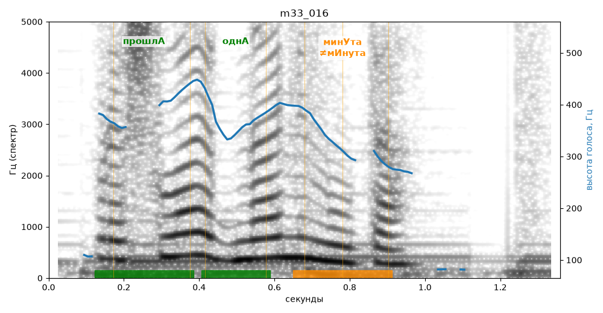

# m33_016

Голос: **Серия 33, Пик (103.3 с), голос iPhone** · длительность 1.4 с
Естественность (UTMOS): **1.38 из 5** (живой диктор ≈ 4–4.5)
Эталон: Прошла одна минута.
Распознано: Прошла одна минута.
Слова: все совпали

## Ударения
(где нужно: ruaccent)

| слово | нужно | у голоса | |
|---|---|---|---|
| прошла | прошлА | прошлА | ✓ |
| одна | однА | однА | ✓ |
| минута | минУта | мИнута | ✗? возможно — послушать |

## Интонация
- ✓ «прошла одна минута.» — конец фразы понижается — звучит законченно
- Диапазон голоса 28.8 полутонов (живо), средняя высота 362 Гц

## Паузы и темп
- паузы на своих местах
- Темп 8.8 слога/с (быстро)

_Синяя линия — высота голоса. Над словами заглавная буква — где ударение должно быть; красным — голос поставил не туда (уверенно), оранжевым — возможно._
