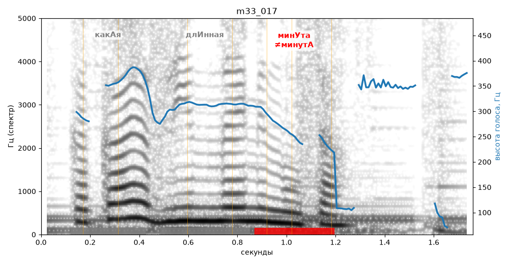

# m33_017

Голос: **Серия 33, Рон (104.6 с), голос iPhone** · длительность 1.8 с
Естественность (UTMOS): **1.76 из 5** (живой диктор ≈ 4–4.5)
Эталон: Какая длинная минута.
Распознано: Какая длинная минута.
Слова: все совпали

## Ударения
(где нужно: ruaccent)

| слово | нужно | у голоса | |
|---|---|---|---|
| какая | какАя | — | ? |
| длинная | длИнная | — | ? |
| минута | минУта | минутА | ✗ ОШИБКА |

## Интонация
- ✓ «какая длинная минута.» — конец фразы понижается — звучит законченно
- Диапазон голоса 21.6 полутонов (живо), средняя высота 313 Гц

## Паузы и темп
- паузы на своих местах
- Темп 6.5 слога/с (нормально)

_Синяя линия — высота голоса. Над словами заглавная буква — где ударение должно быть; красным — голос поставил не туда (уверенно), оранжевым — возможно._
