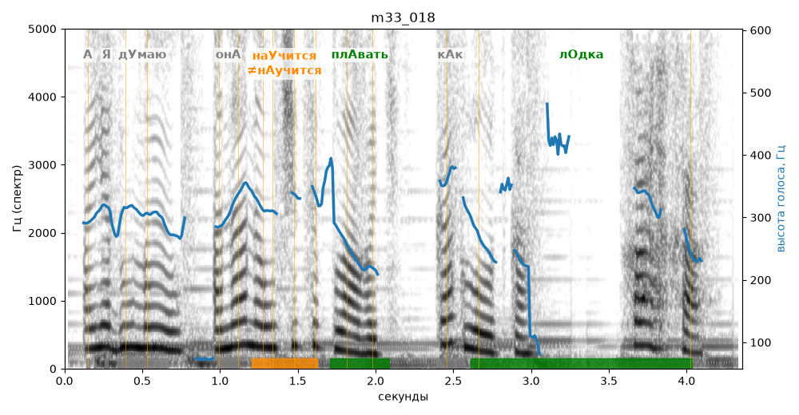

# m33_018

Голос: **Серия 33, Рон (121.0 с), голос iPhone** · длительность 4.4 с
Естественность (UTMOS): **1.48 из 5** (живой диктор ≈ 4–4.5)
Эталон: А я думаю, она научится плавать. Как лодка!
Распознано: А я думаю, она научится плавать, как лодка. Ха-ха!
Расхождения в словах: «» → «ха-ха»

## Ударения
(где нужно: ruaccent)

| слово | нужно | у голоса | |
|---|---|---|---|
| думаю | дУмаю | — | ? |
| она | онА | Она | ? не разобрать |
| научится | наУчится | нАучится | ✗? возможно — послушать |
| плавать | плАвать | плАвать | ✓ |
| лодка | лОдка | лОдка | ✓ |

## Интонация
- ✓ «а я думаю она научится плавать.» — конец фразы понижается — звучит законченно
- ✓ «как лодка!» — выделено слово «как» (+5.2 пт)
- Диапазон голоса 24.0 полутонов (живо), средняя высота 305 Гц

## Паузы и темп
- паузы на своих местах
- Темп 4.3 слога/с (нормально)

_Синяя линия — высота голоса. Над словами заглавная буква — где ударение должно быть; красным — голос поставил не туда (уверенно), оранжевым — возможно._
