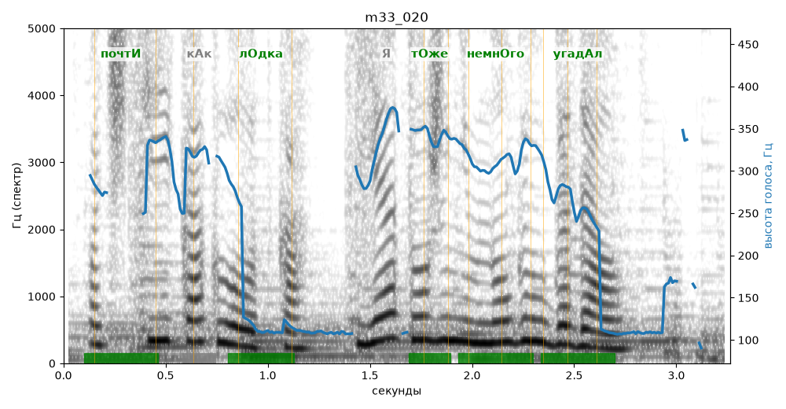

# m33_020

Голос: **Серия 33, Рон (136.1 с), голос iPhone** · длительность 3.3 с
Естественность (UTMOS): **1.39 из 5** (живой диктор ≈ 4–4.5)
Эталон: Почти как лодка. Я тоже немного угадал.
Распознано: Почти как лодка, я тоже немного угадал.
Слова: все совпали

## Ударения
(где нужно: ruaccent)

| слово | нужно | у голоса | |
|---|---|---|---|
| почти | почтИ | почтИ | ✓ |
| лодка | лОдка | лОдка | ✓ |
| тоже | тОже | тОже | ✓ |
| немного | немнОго | немнОго | ✓ |
| угадал | угадАл | угадАл | ✓ |

## Интонация
- ✓ «почти как лодка.» — конец фразы понижается — звучит законченно
- ✓ «я тоже немного угадал.» — конец фразы понижается — звучит законченно
- Диапазон голоса 20.4 полутонов (живо), средняя высота 279 Гц

## Паузы и темп
- паузы на своих местах
- Темп 6.0 слога/с (нормально)

_Синяя линия — высота голоса. Над словами заглавная буква — где ударение должно быть; красным — голос поставил не туда (уверенно), оранжевым — возможно._
