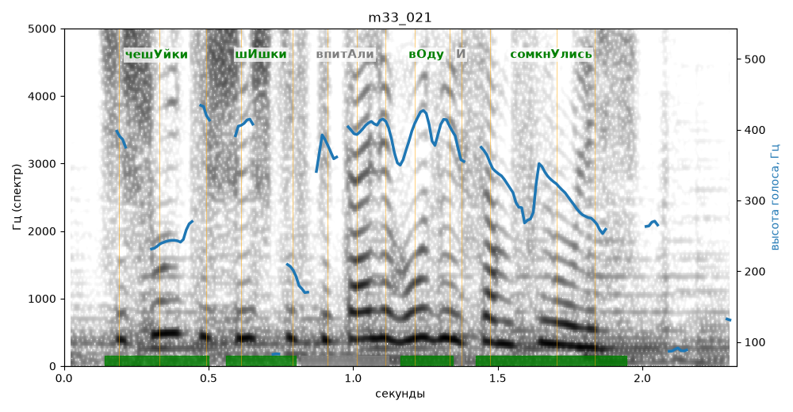

# m33_021

Голос: **Серия 33, Пик (139.3 с), голос iPhone** · длительность 2.3 с
Естественность (UTMOS): **1.31 из 5** (живой диктор ≈ 4–4.5)
Эталон: Чешуйки шишки впитали воду и сомкнулись.
Распознано: Чешуйки, шишки впитали в воду и сам снулись.
Расхождения в словах: «» → «в»; «сомкнулись» → «сам снулись»

## Ударения
(где нужно: ruaccent)

| слово | нужно | у голоса | |
|---|---|---|---|
| чешуйки | чешУйки | чешУйки | ✓ |
| шишки | шИшки | шИшки | ✓ |
| впитали | впитАли | впИтали | ? не разобрать |
| воду | вОду | вОду | ✓ |
| сомкнулись | сомкнУлись | сомкнУлись | ✓ |

## Интонация
- ✓ «чешуйки шишки впитали воду и сомкнулись.» — конец фразы понижается — звучит законченно
- Диапазон голоса 26.7 полутонов (живо), средняя высота 336 Гц

## Паузы и темп
- паузы на своих местах
- Темп 7.8 слога/с (быстро)

_Синяя линия — высота голоса. Над словами заглавная буква — где ударение должно быть; красным — голос поставил не туда (уверенно), оранжевым — возможно._
