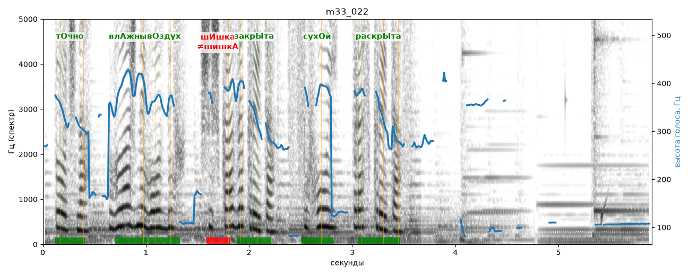

# m33_022

Голос: **Серия 33, Пик (155.2 с), голос iPhone** · длительность 5.9 с
Естественность (UTMOS): **1.25 из 5** (живой диктор ≈ 4–4.5)
Эталон: Точно. Влажный воздух — шишка закрыта. Сухой — раскрыта.
Распознано: Точно! Влажный воздух, шишка закрыта! Сухой, раскрыта!
Слова: все совпали

## Ударения
(где нужно: ruaccent)

| слово | нужно | у голоса | |
|---|---|---|---|
| точно | тОчно | тОчно | ✓ |
| влажный | влАжный | влАжный | ✓ |
| воздух | вОздух | вОздух | ✓ |
| шишка | шИшка | шишкА | ✗ ОШИБКА |
| закрыта | закрЫта | закрЫта | ✓ |
| сухой | сухОй | сухОй | ✓ |
| раскрыта | раскрЫта | раскрЫта | ✓ |

## Интонация
- ✓ «влажный воздух шишка закрыта.» — конец фразы понижается — звучит законченно
- ✗ «сухой раскрыта.» — конец фразы не понижается — звучит незаконченно / как перечисление
- Диапазон голоса 25.5 полутонов (живо), средняя высота 296 Гц

## Паузы и темп
- паузы на своих местах
- Темп 7.2 слога/с (быстро)

_Синяя линия — высота голоса. Над словами заглавная буква — где ударение должно быть; красным — голос поставил не туда (уверенно), оранжевым — возможно._
