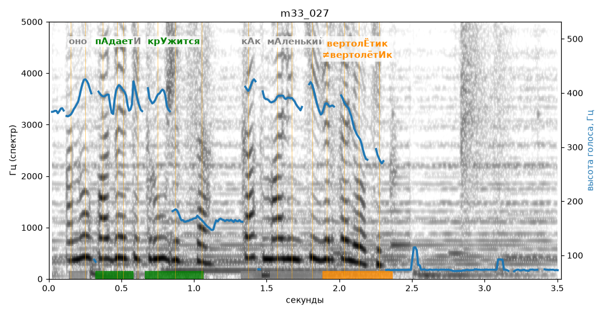

# m33_027

Голос: **Серия 33, Пик (181.9 с), голос iPhone** · длительность 3.5 с
Естественность (UTMOS): **1.28 из 5** (живой диктор ≈ 4–4.5)
Эталон: Оно падает и кружится, как маленький вертолётик.
Распознано: Оно под этим кружится, как маленький вертолетик.
Расхождения в словах: «падает и» → «под этим»

## Ударения
(где нужно: ruaccent)

| слово | нужно | у голоса | |
|---|---|---|---|
| оно | оно | онО | нет эталона |
| падает | пАдает | пАдает | ✓ |
| кружится | крУжится | крУжится | ✓ |
| маленький | мАленький | маленькИй | ? не разобрать |
| вертолётик | вертолЁтик | вертолётИк | ✗? возможно — послушать |

## Интонация
- ✓ «оно падает и кружится как маленький вертолётик.» — конец фразы понижается — звучит законченно
- Диапазон голоса 30.1 полутонов (живо), средняя высота 172 Гц

## Паузы и темп
- паузы на своих местах
- Темп 8.7 слога/с (быстро)

_Синяя линия — высота голоса. Над словами заглавная буква — где ударение должно быть; красным — голос поставил не туда (уверенно), оранжевым — возможно._
