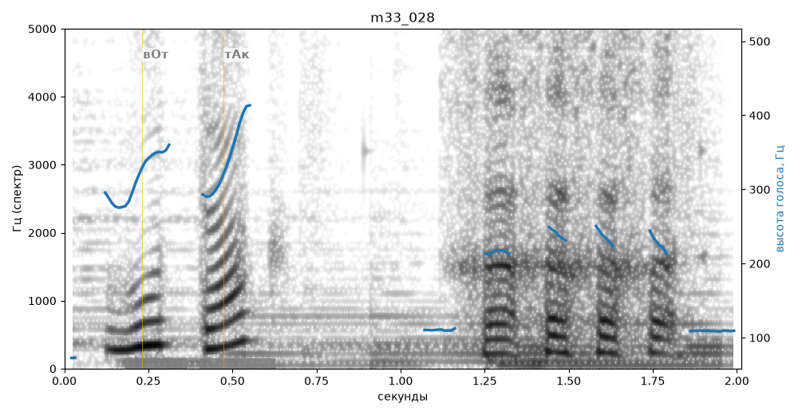

# m33_028

Голос: **Серия 33, Рон (185.4 с), голос iPhone** · длительность 2.0 с
Естественность (UTMOS): **1.43 из 5** (живой диктор ≈ 4–4.5)
Эталон: Вот так?
Распознано: Вот так?
Слова: все совпали

## Ударения
(где нужно: дано в тексте)

| слово | нужно | у голоса | |
|---|---|---|---|

## Интонация
- Диапазон голоса 21.1 полутонов (живо), средняя высота 235 Гц

## Паузы и темп
- паузы на своих местах
- Темп 4.5 слога/с (нормально)

_Синяя линия — высота голоса. Над словами заглавная буква — где ударение должно быть; красным — голос поставил не туда (уверенно), оранжевым — возможно._
