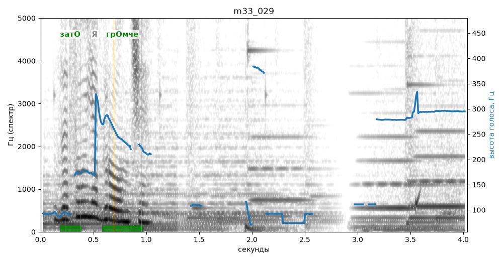

# m33_029

Голос: **Серия 33, Рон (189.1 с), голос iPhone** · длительность 4.0 с
Естественность (UTMOS): **1.35 из 5** (живой диктор ≈ 4–4.5)
Эталон: Зато я громче!
Распознано: Зато я громче.
Слова: все совпали

## Ударения
(где нужно: ruaccent)

| слово | нужно | у голоса | |
|---|---|---|---|
| зато | затО | затО | ✓ |
| громче | грОмче | грОмче | ✓ |

## Интонация
- ✓ «зато я громче!» — выделено слово «громче» (+5.3 пт)
- Диапазон голоса 25.6 полутонов (живо), средняя высота 216 Гц

## Паузы и темп
- паузы на своих местах
- Темп 5.1 слога/с (нормально)

_Синяя линия — высота голоса. Над словами заглавная буква — где ударение должно быть; красным — голос поставил не туда (уверенно), оранжевым — возможно._
