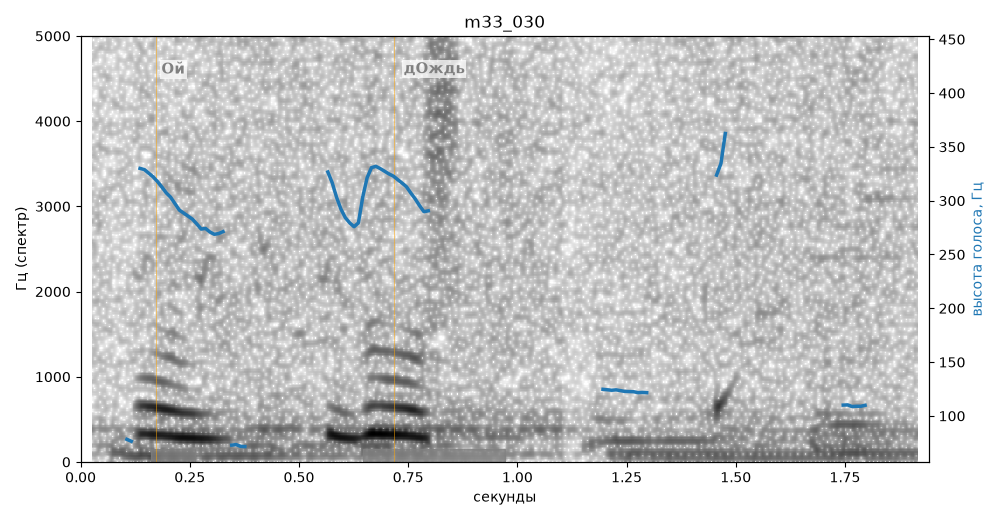

# m33_030

Голос: **Серия 33, Рон (207.5 с), голос iPhone** · длительность 1.9 с
Естественность (UTMOS): **1.3 из 5** (живой диктор ≈ 4–4.5)
Эталон: Ой! Дождь!
Распознано: Ой, дождь!
Слова: все совпали

## Ударения
(где нужно: дано в тексте)

| слово | нужно | у голоса | |
|---|---|---|---|

## Интонация
- Диапазон голоса 25.7 полутонов (живо), средняя высота 285 Гц

## Паузы и темп
- паузы на своих местах
- Темп 4.7 слога/с (нормально)

_Синяя линия — высота голоса. Над словами заглавная буква — где ударение должно быть; красным — голос поставил не туда (уверенно), оранжевым — возможно._
