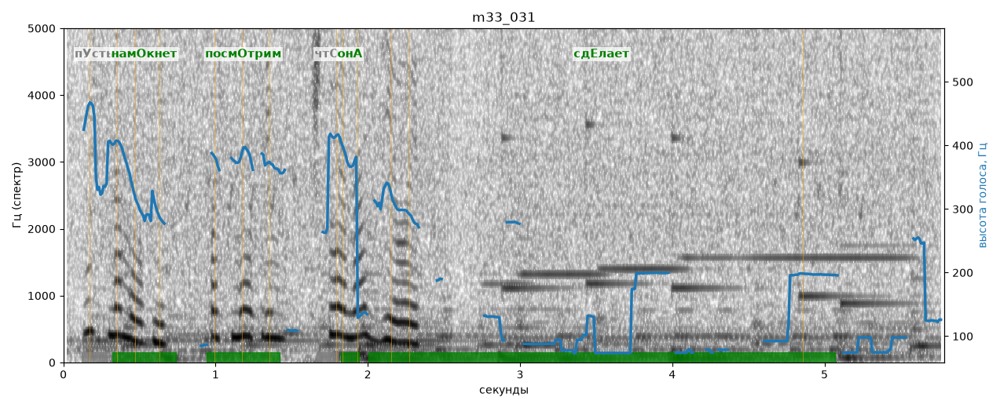

# m33_031

Голос: **Серия 33, Пик (211.4 с), голос iPhone** · длительность 5.8 с
Естественность (UTMOS): **1.28 из 5** (живой диктор ≈ 4–4.5)
Эталон: Пусть намокнет. Посмотрим, что она сделает.
Распознано: Пусть намокнет. Посмотрим, что она делает.
Расхождения в словах: «сделает» → «делает»

## Ударения
(где нужно: ruaccent)

| слово | нужно | у голоса | |
|---|---|---|---|
| намокнет | намОкнет | намОкнет | ✓ |
| посмотрим | посмОтрим | посмОтрим | ✓ |
| она | онА | онА | ✓ |
| сделает | сдЕлает | сдЕлает | ✓ |

## Интонация
- ✓ «пусть намокнет.» — конец фразы понижается — звучит законченно
- ✓ «посмотрим что она сделает.» — конец фразы понижается — звучит законченно
- Диапазон голоса 29.6 полутонов (живо), средняя высота 196 Гц

## Паузы и темп
- паузы на своих местах
- Темп 2.9 слога/с (медленно)

_Синяя линия — высота голоса. Над словами заглавная буква — где ударение должно быть; красным — голос поставил не туда (уверенно), оранжевым — возможно._
