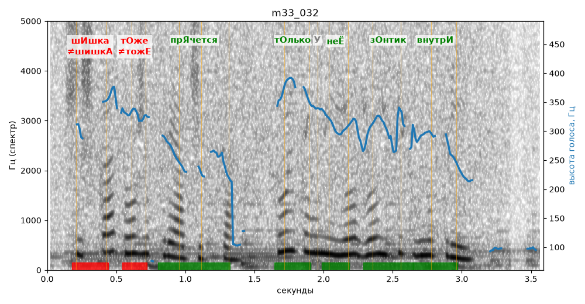

# m33_032

Голос: **Серия 33, Рон (220.2 с), голос iPhone** · длительность 3.6 с
Естественность (UTMOS): **1.26 из 5** (живой диктор ≈ 4–4.5)
Эталон: Шишка тоже прячется. Только у неё зонтик внутри!
Распознано: Шишка тоже прячется, только у нее жойтик внутри.
Расхождения в словах: «зонтик» → «жойтик»

## Ударения
(где нужно: ruaccent)

| слово | нужно | у голоса | |
|---|---|---|---|
| шишка | шИшка | шишкА | ✗ ОШИБКА |
| тоже | тОже | тожЕ | ✗ ОШИБКА |
| прячется | прЯчется | прЯчется | ✓ |
| только | тОлько | тОлько | ✓ |
| неё | неЁ | неЁ | ✓ |
| зонтик | зОнтик | зОнтик | ✓ |
| внутри | внутрИ | внутрИ | ✓ |

## Интонация
- ✓ «шишка тоже прячется.» — конец фразы понижается — звучит законченно
- ✓ «только у неё зонтик внутри!» — выделено слово «только» (+3.6 пт)
- Диапазон голоса 23.2 полутонов (живо), средняя высота 296 Гц

## Паузы и темп
- паузы на своих местах
- Темп 6.5 слога/с (нормально)

_Синяя линия — высота голоса. Над словами заглавная буква — где ударение должно быть; красным — голос поставил не туда (уверенно), оранжевым — возможно._
