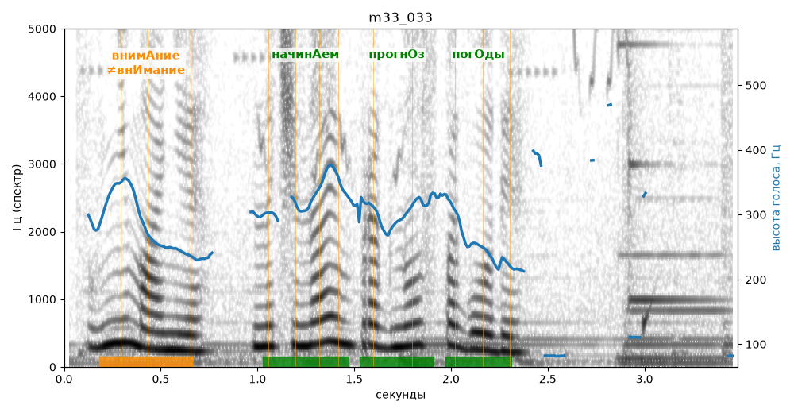

# m33_033

Голос: **Серия 33, Рон (227.4 с), голос iPhone** · длительность 3.5 с
Естественность (UTMOS): **1.99 из 5** (живой диктор ≈ 4–4.5)
Эталон: Внимание! Начинаем прогноз погоды!
Распознано: Внимание, начинаем прогноз погоды.
Слова: все совпали

## Ударения
(где нужно: ruaccent)

| слово | нужно | у голоса | |
|---|---|---|---|
| внимание | внимАние | внИмание | ✗? возможно — послушать |
| начинаем | начинАем | начинАем | ✓ |
| прогноз | прогнОз | прогнОз | ✓ |
| погоды | погОды | погОды | ✓ |

## Интонация
- ✗ «внимание!» — восклицание звучит ровно, без эмоции
- ✗ «начинаем прогноз погоды!» — восклицание звучит ровно, без эмоции
- Диапазон голоса 26.2 полутонов (живо), средняя высота 297 Гц

## Паузы и темп
- паузы на своих местах
- Темп 7.3 слога/с (быстро)

_Синяя линия — высота голоса. Над словами заглавная буква — где ударение должно быть; красным — голос поставил не туда (уверенно), оранжевым — возможно._
