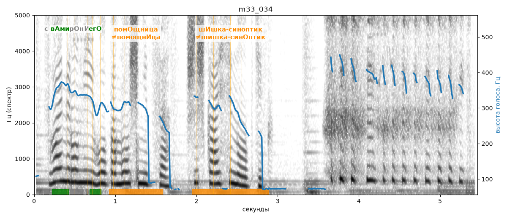

# m33_034

Голос: **Серия 33, Рон (230.8 с), голос iPhone** · длительность 5.5 с
Естественность (UTMOS): **1.47 из 5** (живой диктор ≈ 4–4.5)
Эталон: С вами Рон и его помощница — шишка-синоптик.
Распознано: С вами Рунеего помощница, Шишка Синоптик.
Расхождения в словах: «рон и его» → «рунеего»; «шишка-синоптик» → «шишка синоптик»

## Ударения
(где нужно: ruaccent)

| слово | нужно | у голоса | |
|---|---|---|---|
| вами | вАми | вАми | ✓ |
| его | егО | егО | ✓ |
| помощница | помОщница | помощнИца | ✗? возможно — послушать |
| шишка-синоптик | шИшка-синоптик | шишка-синОптик | ✗? возможно — послушать |

## Интонация
- ✗ «с вами рон и его помощница шишка-синоптик.» — конец фразы не понижается — звучит незаконченно / как перечисление
- Диапазон голоса 29.8 полутонов (живо), средняя высота 309 Гц

## Паузы и темп
- паузы на своих местах
- Темп 6.6 слога/с (быстро)

_Синяя линия — высота голоса. Над словами заглавная буква — где ударение должно быть; красным — голос поставил не туда (уверенно), оранжевым — возможно._
