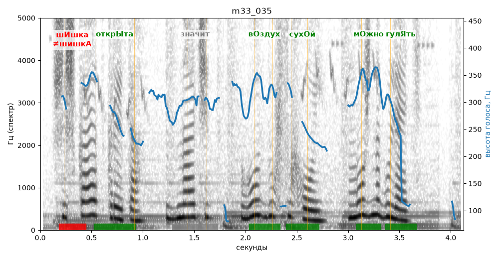

# m33_035

Голос: **Серия 33, Рон (236.2 с), голос iPhone** · длительность 4.1 с
Естественность (UTMOS): **1.57 из 5** (живой диктор ≈ 4–4.5)
Эталон: Шишка открыта. Значит, воздух сухой. Можно гулять!
Распознано: Шишка открыта, значит воздух сухой. Можно гулять.
Слова: все совпали

## Ударения
(где нужно: ruaccent)

| слово | нужно | у голоса | |
|---|---|---|---|
| шишка | шИшка | шишкА | ✗ ОШИБКА |
| открыта | открЫта | открЫта | ✓ |
| значит | значит | знАчит | нет эталона |
| воздух | вОздух | вОздух | ✓ |
| сухой | сухОй | сухОй | ✓ |
| можно | мОжно | мОжно | ✓ |
| гулять | гулЯть | гулЯть | ✓ |

## Интонация
- ✓ «шишка открыта.» — конец фразы понижается — звучит законченно
- ✓ «значит воздух сухой.» — конец фразы понижается — звучит законченно
- ✗ «можно гулять!» — восклицание звучит ровно, без эмоции
- Диапазон голоса 20.4 полутонов (живо), средняя высота 299 Гц

## Паузы и темп
- паузы на своих местах
- Темп 6.1 слога/с (нормально)

_Синяя линия — высота голоса. Над словами заглавная буква — где ударение должно быть; красным — голос поставил не туда (уверенно), оранжевым — возможно._
