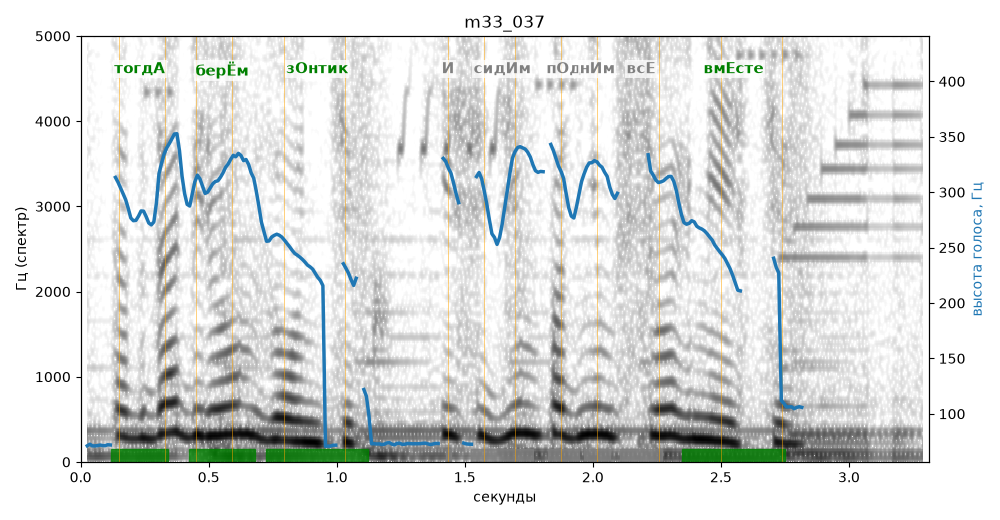

# m33_037

Голос: **Серия 33, Рон (242.0 с), голос iPhone** · длительность 3.3 с
Естественность (UTMOS): **1.48 из 5** (живой диктор ≈ 4–4.5)
Эталон: Тогда берём зонтик. И сидим под ним все вместе.
Распознано: тогда берем зонтик и сидим под ним все вместе.
Слова: все совпали

## Ударения
(где нужно: ruaccent)

| слово | нужно | у голоса | |
|---|---|---|---|
| тогда | тогдА | тогдА | ✓ |
| берём | берЁм | берЁм | ✓ |
| зонтик | зОнтик | зОнтик | ✓ |
| сидим | сидИм | сИдим | ? не разобрать |
| вместе | вмЕсте | вмЕсте | ✓ |

## Интонация
- ✓ «тогда берём зонтик.» — конец фразы понижается — звучит законченно
- ✓ «и сидим под ним все вместе.» — конец фразы понижается — звучит законченно
- Диапазон голоса 26.7 полутонов (живо), средняя высота 274 Гц

## Паузы и темп
- паузы на своих местах
- Темп 6.0 слога/с (нормально)

_Синяя линия — высота голоса. Над словами заглавная буква — где ударение должно быть; красным — голос поставил не туда (уверенно), оранжевым — возможно._
