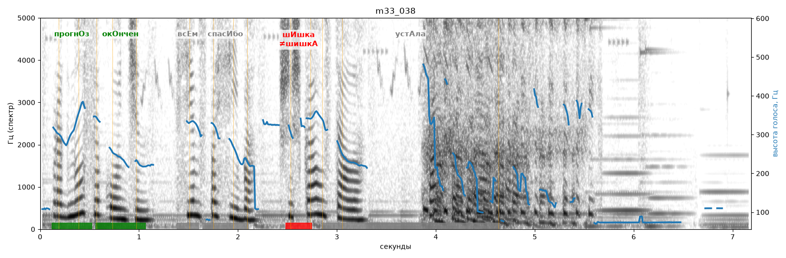

# m33_038

Голос: **Серия 33, Рон (253.6 с), голос iPhone** · длительность 7.2 с
Естественность (UTMOS): **1.31 из 5** (живой диктор ≈ 4–4.5)
Эталон: Прогноз окончен. Всем спасибо. Шишка устала.
Распознано: Прогноз закончен. Всем спасибо. Шишка устала.
Расхождения в словах: «окончен» → «закончен»

## Ударения
(где нужно: ruaccent)

| слово | нужно | у голоса | |
|---|---|---|---|
| прогноз | прогнОз | прогнОз | ✓ |
| окончен | окОнчен | окОнчен | ✓ |
| спасибо | спасИбо | спАсибо | ? не разобрать |
| шишка | шИшка | шишкА | ✗ ОШИБКА |
| устала | устАла | усталА | ? не разобрать |

## Интонация
- ✓ «прогноз окончен.» — конец фразы понижается — звучит законченно
- ✓ «всем спасибо.» — конец фразы понижается — звучит законченно
- ✓ «шишка устала.» — конец фразы понижается — звучит законченно
- Диапазон голоса 28.0 полутонов (живо), средняя высота 221 Гц

## Паузы и темп
- паузы на своих местах
- Темп 3.7 слога/с (медленно)

_Синяя линия — высота голоса. Над словами заглавная буква — где ударение должно быть; красным — голос поставил не туда (уверенно), оранжевым — возможно._
