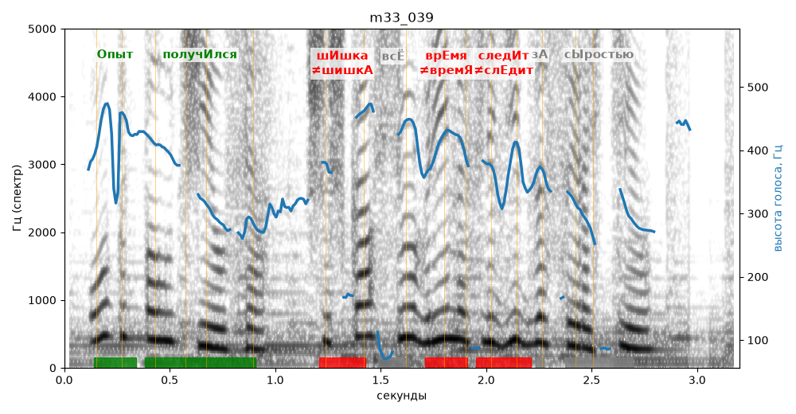

# m33_039

Голос: **Серия 33, Пик (269.9 с), голос iPhone** · длительность 3.2 с
Естественность (UTMOS): **1.26 из 5** (живой диктор ≈ 4–4.5)
Эталон: Опыт получился. Шишка всё время следит за сыростью.
Распознано: О, ты получился! Шишка всё время следит за сыростью!
Расхождения в словах: «опыт» → «о ты»

## Ударения
(где нужно: ruaccent)

| слово | нужно | у голоса | |
|---|---|---|---|
| опыт | Опыт | Опыт | ✓ |
| получился | получИлся | получИлся | ✓ |
| шишка | шИшка | шишкА | ✗ ОШИБКА |
| время | врЕмя | времЯ | ✗ ОШИБКА |
| следит | следИт | слЕдит | ✗ ОШИБКА |
| сыростью | сЫростью | — | ? |

## Интонация
- ✓ «опыт получился.» — конец фразы понижается — звучит законченно
- ✓ «шишка всё время следит за сыростью.» — конец фразы понижается — звучит законченно
- Диапазон голоса 28.7 полутонов (живо), средняя высота 342 Гц

## Паузы и темп
- паузы на своих местах
- Темп 7.1 слога/с (быстро)

_Синяя линия — высота голоса. Над словами заглавная буква — где ударение должно быть; красным — голос поставил не туда (уверенно), оранжевым — возможно._
