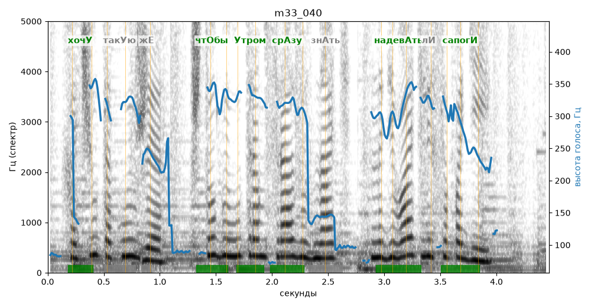

# m33_040

Голос: **Серия 33, Рон (273.1 с), голос iPhone** · длительность 4.5 с
Естественность (UTMOS): **1.29 из 5** (живой диктор ≈ 4–4.5)
Эталон: Хочу такую же. Чтобы утром сразу знать, надевать ли сапоги.
Распознано: Хочу такую же, чтобы утром сразу знать надевать лесопаги.
Расхождения в словах: «ли сапоги» → «лесопаги»

## Ударения
(где нужно: ruaccent)

| слово | нужно | у голоса | |
|---|---|---|---|
| хочу | хочУ | хочУ | ✓ |
| такую | такУю | — | ? |
| чтобы | чтОбы | чтОбы | ✓ |
| утром | Утром | Утром | ✓ |
| сразу | срАзу | срАзу | ✓ |
| надевать | надевАть | надевАть | ✓ |
| сапоги | сапогИ | сапогИ | ✓ |

## Интонация
- ✓ «хочу такую же.» — конец фразы понижается — звучит законченно
- ✓ «чтобы утром сразу знать надевать ли сапоги.» — конец фразы понижается — звучит законченно
- Диапазон голоса 24.4 полутонов (живо), средняя высота 293 Гц

## Паузы и темп
- паузы на своих местах
- Темп 6.4 слога/с (нормально)

_Синяя линия — высота голоса. Над словами заглавная буква — где ударение должно быть; красным — голос поставил не туда (уверенно), оранжевым — возможно._
