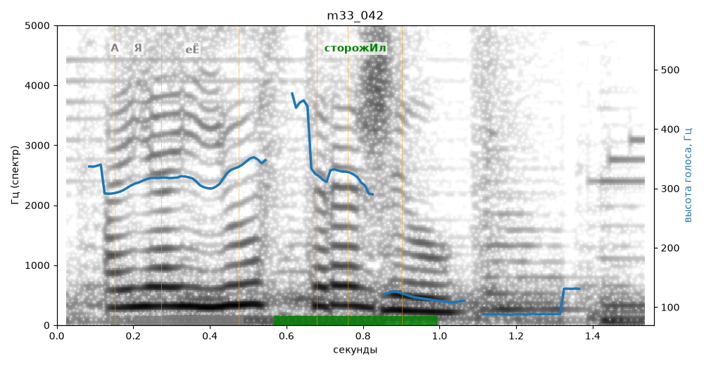

# m33_042

Голос: **Серия 33, Рон (294.5 с), голос iPhone** · длительность 1.6 с
Естественность (UTMOS): **1.98 из 5** (живой диктор ≈ 4–4.5)
Эталон: А я её сторожил!
Распознано: А я её строжил.
Расхождения в словах: «сторожил» → «строжил»

## Ударения
(где нужно: ruaccent)

| слово | нужно | у голоса | |
|---|---|---|---|
| её | еЁ | Её | ? не разобрать |
| сторожил | сторожИл | сторожИл | ✓ |

## Интонация
- ✗ «а я её сторожил!» — восклицание звучит ровно, без эмоции
- Диапазон голоса 24.0 полутонов (живо), средняя высота 301 Гц

## Паузы и темп
- паузы на своих местах
- Темп 7.1 слога/с (быстро)

_Синяя линия — высота голоса. Над словами заглавная буква — где ударение должно быть; красным — голос поставил не туда (уверенно), оранжевым — возможно._
