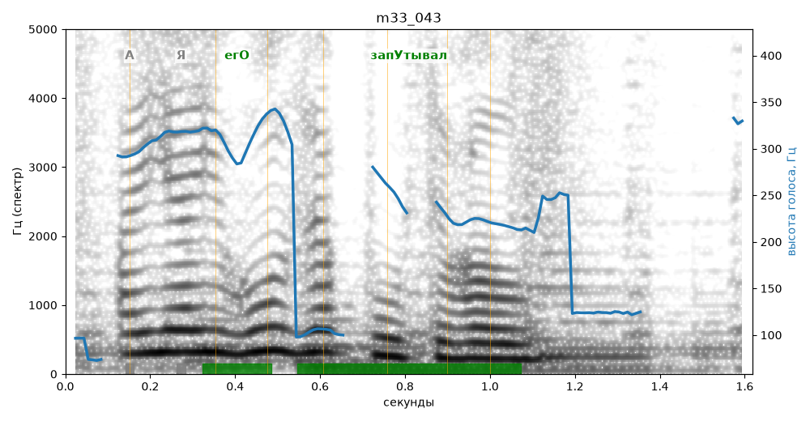

# m33_043

Голос: **Серия 33, Рон (298.6 с), голос iPhone** · длительность 1.6 с
Естественность (UTMOS): **1.41 из 5** (живой диктор ≈ 4–4.5)
Эталон: А я его запутывал!
Распознано: А я его запутывал.
Слова: все совпали

## Ударения
(где нужно: ruaccent)

| слово | нужно | у голоса | |
|---|---|---|---|
| его | егО | егО | ✓ |
| запутывал | запУтывал | запУтывал | ✓ |

## Интонация
- ✓ «а я его запутывал!» — выделено слово «его» (+4.1 пт)
- Диапазон голоса 21.2 полутонов (живо), средняя высота 237 Гц

## Паузы и темп
- паузы на своих местах
- Темп 7.5 слога/с (быстро)

_Синяя линия — высота голоса. Над словами заглавная буква — где ударение должно быть; красным — голос поставил не туда (уверенно), оранжевым — возможно._
